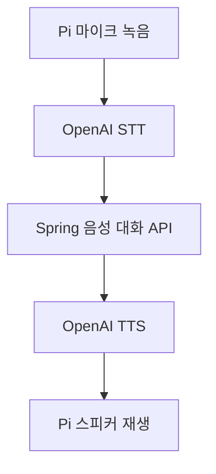

# Raspberry Voice Duck

Raspberry Pi에서 실행되는 Ducky 음성 클라이언트입니다. Pi의 마이크와 스피커로 대화하고, Spring에서 세션을 이어가며 기기 상태를 보고합니다.

[하드웨어 구성](../README.md) · [서버 기기 등록](../../Ducky_was/README.md#라즈베리파이-기기-등록) · [Nano 버튼·LED](../arduino/nano_button_led/README.md)

## 음성 대화



이 저장소의 클라이언트는 온라인 음성 변환을 사용합니다. 서버 통신이 실패하면 장치 상태에 반영되며, Nano를 연결한 경우 오프라인 LED로 상태를 확인할 수 있습니다.

## 설치와 실행

Pi의 이 디렉터리에서 실행합니다.

```sh
sudo apt update
sudo apt install -y ffmpeg mpg123 alsa-utils python3-venv
python3 -m venv venv
. venv/bin/activate
python -m pip install -r requirements.txt
```

[서버 기기 등록](../../Ducky_was/README.md#라즈베리파이-기기-등록) 과정에서 이 디렉터리의 `.env`에 `DEVICE_TOKEN`이 기록됩니다. 같은 파일에 나머지 설정을 입력합니다.

| 변수 | 값 또는 용도 |
| --- | --- |
| `DEVICE_TOKEN` | 백엔드에 등록한 기기 키 |
| `DEVICE_ID`, `SERVER_BASE_URL` | 등록 기기의 시리얼과 Spring 서버 주소 |
| `OPENAI_API_KEY` | STT·TTS를 호출할 때 사용하는 키 |
| `TRIGGER_MODE` | `command`는 웹 녹음 명령, `button`은 웹 명령과 Nano의 물리 버튼 |
| `MIC_DEVICE`, `SPEAKER_DEVICE` | ALSA 입력·출력 장치. `arecord -l`, `aplay -l`로 확인합니다. |
| `NANO_SERIAL_PORT`, `NANO_SERIAL_BAUD_RATE` | Nano 시리얼 장치와 전송 속도. 기본 `/dev/ttyUSB0`, `115200` |

```sh
python main.py
```

`main.py`가 녹음과 응답 재생을 조율합니다. [audio_io.py](audio_io.py)는 ALSA 입출력, [server_client.py](server_client.py)는 대화·장치 API, [nano_serial.py](nano_serial.py)는 Nano 시리얼 통신을 담당합니다. 음성 모델과 추가 환경 변수의 기본값은 [config.py](config.py)에 있습니다.

<details>
<summary>음성 대화 API 요청과 응답 예시</summary>

### 상태 확인

```http
GET /api/health
```

### 음성 대화

```http
POST /api/duck/conversation
Authorization: Bearer device.<DEVICE_TOKEN>
Content-Type: application/json
```

요청

```json
{
  "deviceId": "raspberry-duck-001",
  "inputType": "voice",
  "message": "파이썬 반복문에서 인덱스 오류가 나는데 왜 그런지 모르겠어",
  "learningType": {
    "processing": "reflective",
    "expression": "verbal",
    "structure": "sequential"
  }
}
```

응답

```json
{
  "conversationId": 15,
  "responseType": "question",
  "message": "좋아요. 먼저 인덱스 오류가 발생한 반복문의 범위를 확인해볼까요?",
  "hintLevel": 1,
  "shouldSaveLog": true
}
```

`message`는 비어 있지 않은 문자열이어야 합니다. 응답 형식이 잘못되면 해당 턴을 오류로 처리합니다.

### 대화 로그

```http
POST /api/duck/conversation/logs
Authorization: Bearer device.<DEVICE_TOKEN>
Content-Type: application/json
```

요청

```json
{
  "conversationId": 15,
  "deviceId": "raspberry-duck-001",
  "userMessage": "파이썬 반복문에서 인덱스 오류가 나는데 왜 그런지 모르겠어",
  "assistantMessage": "좋아요. 먼저 인덱스 오류가 발생한 반복문의 범위를 확인해볼까요?",
  "sttSuccess": true,
  "ttsSuccess": true
}
```

서버 응답을 사용할 수 없으면 해당 턴의 대화 로그 저장을 건너뜁니다.

</details>
