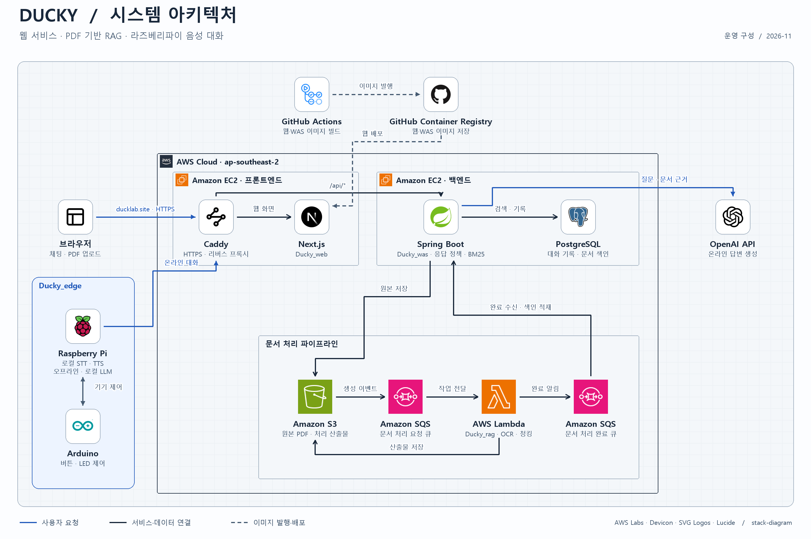

<div align="center">
  
  <h1>Ducky</h1>
  <p><strong>말로 풀어가는 러버덕 디버깅과 학습</strong></p>
  <p>
    <a href="https://ducklab.site">웹 서비스</a> ·
    <a href="#시스템-아키텍처">시스템 아키텍처</a> ·
    <a href="#빠른-시작">빠른 시작</a> ·
    <a href="#저장소-구성">모듈 가이드</a>
  </p>
</div>

## Ducky로 할 수 있는 일

| 기능 | 사용자 흐름 |
| --- | --- |
| **러버덕 디버깅** | 문제 상황과 기대 동작을 설명하면 Ducky가 확인 질문이나 단계별 힌트를 제시합니다. |
| **자료를 참고하는 답변** | 강의 자료나 코드 예제를 업로드하고 질문하면 검색된 문서 발췌와 출처를 대화에서 확인할 수 있습니다. |
| **음성으로 대화** | 브라우저 마이크로 입력하거나, 등록한 Raspberry Pi의 마이크와 스피커로 대화할 수 있습니다. |
| **학습 이어가기** | 학습 유형을 설정하고 세션 기록에서 이전 대화를 다시 열 수 있습니다. |

## 시스템 아키텍처



AWS 문서 모드에서는 S3와 SQS를 통해 Lambda가 원본을 처리하고, Spring이 완료 메시지를 검증해 색인합니다. `Ducky_edge`는 Raspberry Pi에서 로컬 음성 인식·합성·모델 추론을 실행하는 엣지 구현입니다.

로컬 개발에서는 Spring이 Python HTTP 처리기를 호출합니다. 검색과 답변 정책은 Spring이 담당합니다. 자세한 흐름은 [RAG](Ducky_rag/README.md)와 [대화 하네스](Ducky_was/docs/CONVERSATION_HARNESS.md)에서 볼 수 있습니다.

## 빠른 시작

**Java 17 · Node.js 24 이상 · Python 3.12**를 설치하고 저장소 루트에서 실행합니다. Windows PowerShell에서 `npm` 실행이 제한되면 `npm.cmd`를 사용하세요.

```sh
npm run setup:local
npm run dev
```

1. 실행 준비 메시지가 나오면 [로컬 웹](http://127.0.0.1:13000)을 열고 이메일로 로컬 계정을 만듭니다.
2. 학습 유형을 설정하고, 설정의 **자료실**에서 PDF를 올리거나 채팅에 직접 첨부합니다.
3. 문서가 **색인 완료**되면 문서에 있는 내용을 질문하고 답변의 **참고 문서**를 펼칩니다.

| 서비스 | 기본 주소 |
| --- | --- |
| 웹 | [127.0.0.1:13000](http://127.0.0.1:13000) |
| Spring API | [127.0.0.1:18080/api/health](http://127.0.0.1:18080/api/health) |
| 문서 처리기 | [127.0.0.1:18091/health](http://127.0.0.1:18091/health) |

> 초기 설치와 첫 Gradle 빌드에는 네트워크 연결이 필요합니다. 로컬 통합 환경은 H2와 문서 발췌 답변을 사용하며 AWS, Docker, 별도 PostgreSQL, LLM 키 없이 실행됩니다. 운영 모델 답변과 Raspberry Pi 대화에는 각 서비스에 맞는 설정이 필요합니다.

<details>
<summary>포트 변경과 로컬 검증</summary>

```sh
npm run dev -- --api-port 18082 --worker-port 18093 --web-port 13002
npm run test:local
```

- 통합 실행기가 API 주소와 CORS를 맞춥니다. 기본 포트가 이미 사용 중이면 실행을 중단합니다.
- H2 DB와 업로드 파일은 `.runtime/local-dev/<API포트>/`에 보관됩니다. API 포트를 바꾸면 해당 포트의 개발 데이터가 사용됩니다.
- `Ctrl+C`로 이번 실행에서 시작한 서비스를 종료합니다. Java나 Python 코드를 변경하면 재시작하세요.

</details>

## 저장소 구성

| 모듈 | 기술 | 담당 기능 |
| --- | --- | --- |
| [Ducky_web](Ducky_web/README.md) | Next.js 16 · React 19 · TypeScript | 채팅, 학습 기록, 자료실, 음성 입력과 기기 제어 |
| [Ducky_was](Ducky_was/README.md) | Java 17 · Spring Boot · PostgreSQL | 인증, 대화 라우팅, 문서 검색, IoT API |
| [Ducky_rag](Ducky_rag/README.md) | Python 3.12 · PyMuPDF · OCR | 문서 변환, 정규화, 청킹, AWS Lambda 처리 |
| [Ducky_AI_temporary](Ducky_AI_temporary/README.md) | Raspberry Pi · Arduino Nano | 음성 대화 클라이언트, 물리 버튼과 상태 LED |

[개발·운영 인계 문서](docs/DUCKY_1123_HANDOFF.md) · [통합 CI](.github/workflows/ci.yml) · [이미지 발행 워크플로](.github/workflows/publish.yml)

## 팀원과 역할

| 팀원 | 역할 |
| --- | --- |
| [정운](https://github.com/vni911) | PM |
| [혜진](https://github.com/hyeji-neee) | 프론트엔드 |
| [은진](https://github.com/yim-eun-jin) | 백엔드 |
| [문경](https://github.com/mujang3) | 백엔드 · IoT |
| 제환 | AI |
